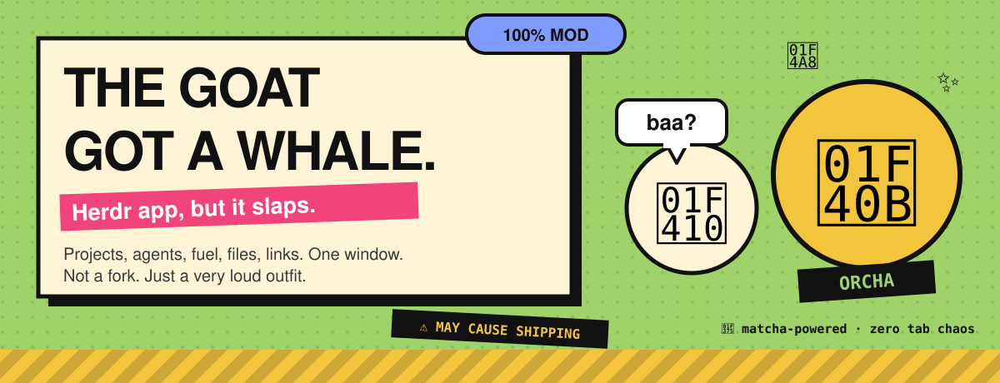
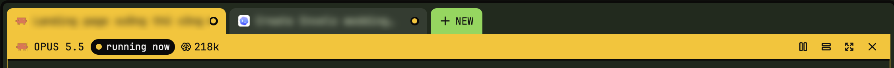

<p align="center"></p>

## Install 🐋

```sh
curl -fsSL https://releases.herdr.dev/app/install.sh | sh                                  # the goat (Herdr)
curl -fsSL https://raw.githubusercontent.com/trungkien1208/orcha-app/HEAD/install.sh | sh  # the whale
```

Herdr → `⌘⇧P` → `layout.switch` → **orcha**. Done.

## Why? 🐐 vs 🐋

<p align="center"></p>

<p align="center"></p>

Not a fork. Just a plugin. Fuel and accounts come from the terminal [orcha](https://github.com/trungkien1208/orcha).

Wanna read the stuff nobody reads? 🥱 [Click here.](docs/BORING.md)

<sub>Apache-2.0 · the goat is Herdr's, the whale is ours 🍵</sub>
