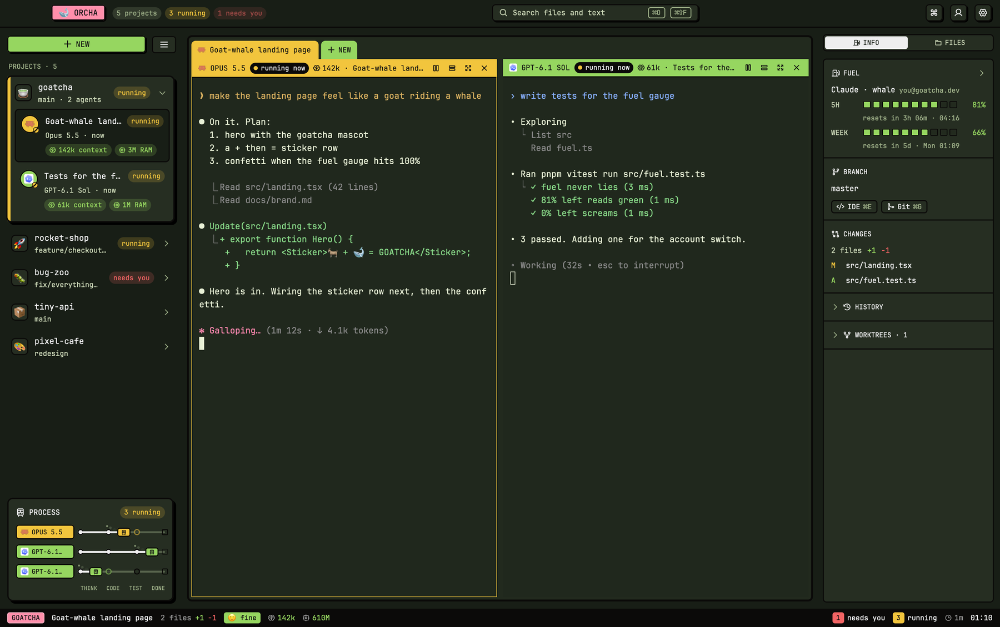
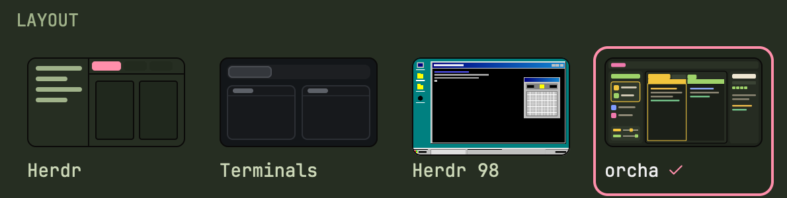

<p align="center"></p>

<p align="center"><b>Herdr's window 🪟 + orcha's brain 🧠 = ORCHERD.</b><br/>A plugin. Not a fork. Absolutely not normal.</p>

## Why? 🐐 + 🐋

<p align="center"></p>

## Look 👀

<p align="center"></p>

## Install 🚀

**Step 1.** Summon the goat 🐐 (skip if Herdr is already in your house):

```sh
curl -fsSL https://releases.herdr.dev/app/install.sh | sh
```

**Step 2.** Release the whale 🐋:

```sh
curl -fsSL https://raw.githubusercontent.com/trungkien1208/orcherd/HEAD/install.sh | sh
```

**Step 3.** Open the goat: launch **Herdr** (Spotlight `⌘Space` → `Herdr`, or `~/Applications/Herdr.app`). Already open? It picks Orcherd up live.

**Step 4.** Tell the goat who's boss: in Herdr's window, `⌘⇧P` → `layout.switch` → **orcha**. Or Settings › Look, click the one with the ✓ energy:

<p align="center"></p>

**Step 5.** There is no step 5. Go ship something. 🫡

<sub>New: import projects from Cursor, Claude and Codex, ⌘F inside files, Codex and Cursor accounts, updates from the header · Before: worktrees in one card like Orca, dev servers with their ports, agents back after a crash, drag to reorder · Fuel and accounts come from the terminal [orcha](https://github.com/trungkien1208/orcha) · update = the pink 🐋 pill in the header (or Settings › 🐋 orcha), or run step 2 again · nerd stuff nobody reads: [click here 🥱](docs/BORING.md) · Apache-2.0 · the goat is Herdr's, the whale is ours 🍵</sub>
