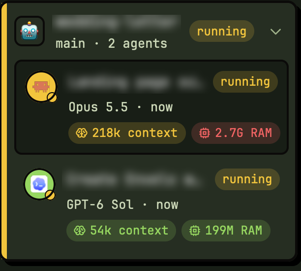
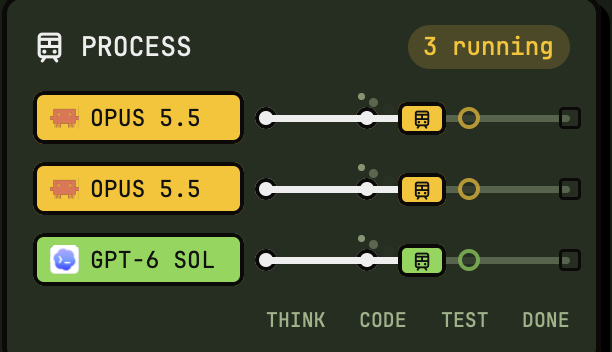

# The boring stuff 🥱

You clicked. Respect. Here's everything nobody reads.

[← back to the fun part](../README.md)

## What you get

<table>
  <tr>
    <td width="50%"></td>
    <td width="50%"></td>
  </tr>
  <tr>
    <td align="center"><sub><b>Projects</b> · open as many as you like, every agent at a glance</sub></td>
    <td align="center"><sub><b>PROCESS</b> · trains. yes, trains. 🚂</sub></td>
  </tr>
</table>

- 🗂 **Projects**: cards per agent (model, context, RAM in green, yellow, red). Pick an icon from ~150 emoji.
- 🚂 **PROCESS**: each working agent is a train between THINK, CODE, TEST and DONE. Click one to jump there.
- ⛽ **FUEL**: what's left on the plan of the agent in front of you: Claude, Codex or Cursor.
- 🔁 **ACCOUNTS**: add one, sign in, **SWITCH** the chat in front of you (keep running, restart, or a new pane with notes).
- 📁 **FILES**: the project's files beside INFO, search by name or text, a viewer next to your work. Markdown reads as a page (flip to SOURCE any time).
- 🔎 **FIND**: `⌘O` a file, `⌘⇧F` text in the project, `⌘F` text in the pane, `⌘L` links.
- 🔗 **Links**: right-click a link in a terminal to open or copy it, even the ones Claude shows only by name, even when they wrap.
- 🎨 **Looks**: folder tabs in the agent's color, Brutal, Matcha and Ocean themes, light and dark.

## Keys

| Keys | Does |
| --- | --- |
| `⌘O` | open a file by name |
| `⌘⇧F` | search text in the project |
| `⌘F` | search what the pane shows |
| `⌘L` | links and paths the pane printed (`⌘C` copies one) |
| `⌘,` | settings |

`⌘P` stays Herdr's terminal picker. All of these work only while the orcha layout is on.


## Accounts, switching and hand-off

- **SWITCH** moves the chat in front of you to an account. Claude to Claude asks how, unless Settings › Hand-off already says:
  - **Keep running**: same chat, no restart; Claude picks up the new sign-in within half a minute. Every chat started in the same folder moves with it.
  - **Restart**: same chat, Claude starts again on the account. Only this pane moves.
  - **New pane**: a new agent opens beside the old one with short notes, sums up and waits for your go.
  - Another kind of agent (Codex, Cursor) always gets a new pane.
- **Two accounts in two projects at once?** Yes: open Claude normally in one, and in the other SWITCH with **Restart** or **New pane**.
- **ADD ACCOUNT** (`a`): name it, sign in in the pane that opens. Chats, settings and skills are shared between accounts.
- **SIGN IN** shows when orcha can't read an account's fuel, with the reason. `r` asks every account right now.
- **Settings › Hand-off** puts three marks on the fuel bar: ask the agent for a checklist, offer to switch, switch by itself. Shared with the terminal orcha; turn on "by itself" in only one of them.


## Opening links and files

A page opens in your browser, a folder in Finder, a picture, PDF or document in its app, code in the viewer at its line (`file.rs:42`). A path that isn't where it says is looked for in the project. Links Claude shows only by name are read from its conversation.

In a split tab, orcha learns where a pane is when the pointer passes over its title bar; if a right-click finds nothing, select the link first.

Open a file type somewhere else in orcha's `config.toml`:

```toml
[orcha.open_with]
md = "editor"          # cursor, code or zed, at the line
png = "system"         # the system's app
log = "folder"         # show it in Finder
rs = "editor:zed {path}:$L"
```


## Something looks wrong

- **Herdr looks the same.** Still on another layout: `⌘⇧P` → `layout.switch` → **orcha**.
- **FUEL and ACCOUNTS are empty.** Install the terminal [orcha](https://github.com/trungkien1208/orcha), then add an account.
- **Signed in, but FUEL says the sign-in expired.** Update the terminal orcha (older ones read the old sign-in), then sign in once more.
- **Herdr says "out of memory" after updates.** Quit it (`⌘Q`) and open it again. Your agents keep running.
- **A panel is blank.** `herdr-app check ~/.config/herdr-app/mods/orcha` says what broke. [Open an issue](https://github.com/trungkien1208/orcha-app/issues) with it.
- **Two Claude chats in one folder show the same model.** Known: they share the folder's newest conversation.
- **Agents gone after a reboot.** Herdr opens fresh shells; it doesn't bring agents back (yet).


## Uninstall, and where the installer writes

Everything lives in `~/.config/herdr-app` (or `$HERDR_APP_HOME`): `layouts/orcha.json`, `themes/orcha-*.json`, `mods/orcha/`, orcha's keys in `keys.json` (only for the orcha layout) and the Matcha theme in `settings.json` if you had none. Herdr's own files and yours are left alone.

```sh
cd ~/.config/herdr-app && rm -rf layouts/orcha.json themes/orcha-*.json mods/orcha
```

Then `⌘⇧P` → `layout.switch` back to another layout.


## For contributors

- `mods/orcha/` is the plugin. `main.js` picks the part a layout block asks for; `ui.js` holds the look.
- `catalog.js` is generated from orcha's `src/orcha_rules.rs`: `python3 gen-catalog.py ../orcha`.
- `settings.js` starts from Herdr's settings page: compare with a new Herdr's `frame/settings/main.js` on updates.
- Animate with Herdr's native `.loop`, `.transition` and `.frames`, never timers.
- Loop: `sh install.sh`, `herdr-app check ~/.config/herdr-app/mods/orcha`, `herdr-app shot shot.png`. Herdr refuses reloads after many in one run: batch your installs.
